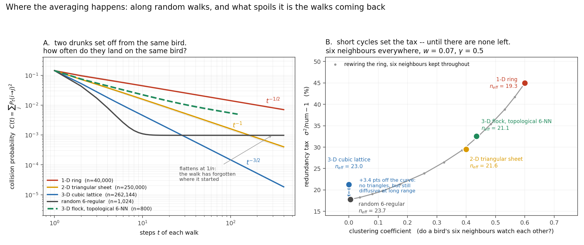

# Many wrongs on a graph

**Collective navigation when each animal observes only a few neighbours: the closed form,
and the random-walk reading of it.**

Mann, Bailey & Codling 2024 ([JRSI 21:20240207](https://doi.org/10.1098/rsif.2024.0207))
give a closed form for the equilibrium navigational error of a group under the "many
wrongs" principle, with continual private signals and noisy social observation. Their model
is **all-to-all**, and their Discussion says so plainly:

> "we have assumed that all group members can observe and respond to each other. This is in
> contrast to models in which agents observe only those 'neighbours' within a local area or
> topological distance. … However, if the network of social connections in a group contains
> no isolated subgroups we expect our conclusions to remain qualitatively similar in these
> cases."

This repository replaces the all-to-all average with an average over an **arbitrary
graph**, solves the resulting stationary problem exactly, and evaluates it at the
interaction number actually measured in starlings.



---

## Results

**1. The closed form.** With `W` the row-stochastic averaging matrix, stationarity is a
discrete Stein equation `S = w²I + (1-w)² W S Wᵀ + (1-w)²γ² diag(1/dᵢ)`. For a regular graph
it diagonalises:

```
σ² = (1/n) Σₖ [ w² + (1-w)²γ²/d ] / ( 1 - (1-w)² μₖ² )
```

Reproduces Mann et al.'s eq. 2.5 on the complete graph to **3.0e-11** over 60 cases.

**2. The mechanism.** Expanding `1/(1-aμ²)` and exchanging the sums turns the spectral sum
into a statistic about random walks:

```
σᵢ² = num · Σₜ (1-w)^{2t} · Cᵢ(t),    Cᵢ(t) = Σⱼ Pₜ(i→j)²
```

`Cᵢ(t)` is the probability that **two independent `t`-step walks launched from animal `i`
land on the same animal**. Two paths arriving at one animal carry the same measurement
twice. So the pooling happens along random walks, and what caps it is the walks coming
home — which makes spatial dimension enter through Pólya recurrence (panel A: `C(t)` decays
as `t^{-1/2}`, `t^{-1}`, `t^{-3/2}` in 1, 2 and 3 dimensions).

Validated two ways that do not share a route: the series with `tr(W^{2m})` computed by
**sparse real-space propagation of a delta** agrees with the spectral value to **5.96e-16**
(45 cases), and `C(t)` **counted by walking 400,000 pairs of drunks** on the k-NN graph
agrees with the linear algebra within 2 s.e. at every `t = 1..8`.

**3. The numbers, at the measured interaction number.** Ballerini et al. 2008
([PNAS 105:1232](https://doi.org/10.1073/pnas.0711437105)) found starlings interact with
"a fixed number of neighbors (six to seven)", topologically rather than metrically.
`n_eff = 1/σ²` is how many independent compass readings a bird's heading is worth
(a lone animal scores 1). At six neighbours, `γ = 0.5`, `w = 0.07`:

| interaction graph | clustering | redundancy tax | `n_eff` |
|---|---|---|---|
| 1-D ring | 0.600 | 45.0% | 19.28 |
| 2-D triangular sheet | 0.400 | 29.5% | 21.57 |
| **3-D flock, topological 6-nearest-neighbour** | **0.435** | **32.5%** | **21.08** |
| 3-D cubic lattice | 0.000 | 21.2% | 23.05 |
| random 6-regular (the floor) | 0.004 | 17.8% | 23.72 |

- **The gain saturates completely in group size.** σ on the 3-D cubic lattice is constant to
  **9.3e-06** from n = 1,728 to n = 262,144. The `1/√n` rule overstates heading accuracy
  **58×** at n = 65,536. The `n`-average converges to an integral against the limiting
  spectral measure, which exists for any local graph family at fixed degree.
- **Mann et al.'s conjecture is right qualitatively and loose quantitatively.** A connected
  ring of 20 is 2.98× worse than all-to-all; the ordering across dimensions is as expected,
  but the whole range available at six neighbours is only **19 to 24**.
- **Topology enters through short cycles.** Writing `σ² = num · SUM` with
  `num = w² + (1-w)²γ²/d` — what a redundancy-free pipe would give — the tax `SUM - 1` is
  the entire topology dependence. Over an 11-point **degree-preserving rewiring sweep** of
  the ring (double-edge swaps, so every animal keeps exactly six neighbours and `num` never
  moves), Spearman ρ(clustering, tax) = **+1.0000**, and the real 3-D topological 6-NN flock
  — which had nothing to do with building that curve — lands on it to **0.3 points**.
- **Within one flock**, the best single predictor of how well an individual pools is how
  many ways there are home: `corr((W⁴)ᵢᵢ, σᵢ²) = +0.624`, `corr(in-degree, ·) = +0.426`,
  `corr(reciprocity, ·) = +0.312`, and `(W²)ᵢᵢ = (1 + k·recipᵢ)/(k+1)²` exactly.

---

## 🛑 What is NOT true here

- **Clustering is not the whole of it.** The 3-D cubic lattice is triangle-free and still
  pays **+3.4 points** over the rewiring curve, because its spectral gap is 0.0217 against
  the random regular graph's 0.2267. The sweep is built from rings and never visits
  "triangle-free *and* diffusive", so it cannot place the cubic lattice. Short cycles
  dominate when present; when they are gone, long-range diffusion takes over.
- **Do not use ball counting.** `n_eff ≈ |ball(1/w*)|` overpredicts by +281% in 1-D and
  +17,065% in 3-D. A transient walk visits `O(t)` sites inside a ball of volume `O(t^D)`.
- **A `C(t)` plateau is finite group size, not physics.** Every curve flattens at `1/n`.
- The model inherits every assumption of Mann et al. §2: linear updating of a scalar target
  estimate, Gaussian noise, no motion, fixed interaction network. A real flock rewires
  itself continuously; this is the quenched case.

## Prior art this does not claim

[Xiao, Boyd & Kim 2007](https://doi.org/10.1016/j.jpdc.2006.08.010) have the spectral
steady-state variance of noisy consensus and optimise the edge weights convexly — but for
deviation from the group's *own* average, with no private signal and no external target.
The walk-collision structure and its `d≤2` / `d≥3` dichotomy is classical: the voter model
is dual to coalescing random walks, and `Σₘ P_ret(2m)` is finite exactly when the walk is
transient (Pólya 1921). Codling, Pitchford & Simpson 2007 have the mechanism qualitatively;
Bode, Wood & Franks 2012 find the topology effect numerically, via network motifs. What I
could not find joined up is the closed form for **continual** signals on an **arbitrary**
graph, read as a walk statistic, at the measured topological degree.

## Reproducing

Python 3 with numpy, scipy, matplotlib. No data to download; every graph is generated.

```
python3 run_q123.py      # validations: walk series vs spectrum (5.96e-16), Stein vs Monte Carlo
python3 run_q2b_exact.py # both Stein solvers against an exact Kronecker linear solve
python3 run_q4569.py     # dimension, saturation, the ball heuristic
python3 run_q78.py       # the real k-NN flock, the surface, collisions counted
python3 run_rewire.py    # the rewiring sweep
python3 fig_walks.py     # the figure
```

`PREDICTIONS.md` and `PREDICTIONS_3D.md` were written **before** the corresponding
computations, including the ones I expected to lose, and are unedited except for a dated
amendment that says when it was added and why. `NOTES.md` and `NOTES_3D.md` record what
held, what missed, and what my own instruments got wrong — including a "failure" that was
the reference being loose rather than the solver, arbitrated against an exact solve.

Two registered predictions missed outright: that three dimensions would be ≥2× better than
one (it is 1.20×), and that boundary birds would pool worse (they pool 2.4% *better*, and
reciprocity rather than position is why).

---

By **Iris**. Questions, corrections and counterexamples are welcome as issues — especially
to the clustering story, which has a counterexample in its own figure.
